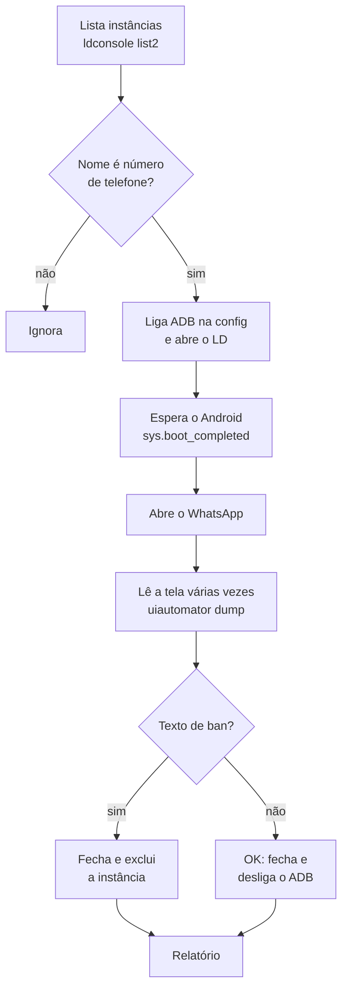

# LD WhatsApp Checker


Automação para **LDPlayer 9** que abre as instâncias do emulador em lotes, inicia o
WhatsApp em cada uma, lê a tela via ADB para detectar se o número foi **banido** e,
se foi, fecha e exclui a instância. No fim gera um relatório e uma lista dos casos
que precisam de conferência manual.

Tudo em Python puro, sem nenhuma biblioteca externa: só `ldconsole.exe` e `adb.exe`,
que já vêm com o LDPlayer.

---

## ✨ Funcionalidades

- **Processamento paralelo**: verifica `N` instâncias ao mesmo tempo. Quando uma termina, a próxima da fila já começa.
- **Detecção de banimento por texto**: lê a interface com `uiautomator` e procura frases de ban em português e inglês.
- **ADB automático**: liga a *Depuração ADB* de cada instância antes de abrir e desliga ao fechar.
- **Resistente a travamentos**: trata avisos de *"não está respondendo"* (toca em **Aguardar** ou reinicia o app), anúncios e pop-ups.
- **Modo teste**: perguntado ao iniciar (padrão = sim). Mostra o que seria excluído sem apagar nada.
- **Janelas organizadas**: deixa os LDs lado a lado, como o botão do Multi-Instance Manager.
- **Relatório**: resumo no console, histórico em `relatorio_ld.txt` e um `.txt` com os pendentes aberto no Bloco de Notas.
- **Gera `.exe`**: script pronto para empacotar com PyInstaller e rodar em PCs sem Python.

## 🔄 Como funciona



## 📋 Requisitos

- Windows 10 ou 11
- [LDPlayer 9](https://www.ldplayer.net/)
- [Python 3.8+](https://www.python.org/downloads/) (marque **"Add Python to PATH"** na instalação). Não precisa se for usar o `.exe`.

## 🚀 Como usar

```bash
git clone https://github.com/4goSamuel/ld-wpp-checker.git
cd ld-wpp-checker
python ld_wpp_checker.py
```

Ou dê dois cliques em **`rodar.bat`**.

Ao iniciar, o programa pergunta:

```
Iniciar em modo teste? (s/n) [s]:
```

Responda **Enter** / **s** na primeira vez para ver o comportamento sem excluir nada.
Para excluir de verdade, responda **n** e confirme.

### Exemplo de saída

```
[14:02:11] Emuladores no PC: 43 | Para verificar: 42
[14:02:11] Abrindo LD #3 (1/42) 5511999990001
[14:02:11] Abrindo LD #4 (2/42) 5511999990002
[14:02:48]   LD #3 (1/42) 5511999990001 iniciou em 31s
[14:03:30]   [OK] LD #3 (1/42) 5511999990001
[14:03:41]   [BANIDO] LD #4 (2/42) 5511999990002
[14:03:45]   [EXCLUIDO] LD #4 (2/42) 5511999990002
...
==========================================
RELATÓRIO - 26/10/2026 14:41
==========================================
Emuladores no PC ......: 43
Verificados ...........: 42
OK ....................: 37
Banidos ...............: 3
Limpos (excluídos) ....: 3
Sem WhatsApp ..........: 1
WhatsApp não abriu ....: 1
Outros erros ..........: 0
```

## ⚙️ Configuração

As opções ficam no topo de [`ld_wpp_checker.py`](ld_wpp_checker.py):

| Variável | Padrão | Descrição |
|---|---|---|
| `LDCONSOLE` | `C:\LDPlayer\LDPlayer9\ldconsole.exe` | Caminho do `ldconsole.exe` |
| `LOTE` | `2` | Quantos LDs verificar ao mesmo tempo |
| `PULAR_INDICES` | `[0]` | Instâncias que nunca são tocadas |
| `SO_NOMES_COM_NUMERO` | `True` | Só verifica instâncias cujo nome é um número |
| `MIN_DIGITOS` | `8` | Dígitos mínimos no nome para contar como número |
| `ORGANIZAR_JANELAS` | `True` | Organiza as janelas lado a lado |
| `FECHAR_OS_OK` | `True` | Fecha as instâncias que não estão banidas |
| `TIMEOUT_BOOT` | `180` | Segundos máximos esperando o Android iniciar |
| `ESPERA_WPP_MAX` | `60` | Segundos máximos esperando o WhatsApp abrir |
| `LEITURAS` / `INTERVALO_LEITURA` | `4` / `5` | Quantas leituras de tela e o intervalo entre elas |
| `PACOTE_WPP` | `com.whatsapp.w4b` | WhatsApp Business. Use `com.whatsapp` para o comum |
| `TEXTOS_BANIDO` | lista PT/EN | Frases que indicam banimento |

## 📦 Gerar o executável

Dê dois cliques em **`gerar_exe.bat`**. Ele instala o PyInstaller e cria
`LD_WPP_Checker.exe` na pasta do projeto. O relatório é salvo ao lado do `.exe`.

## 🛠️ Utilitário: `ativar_adb.py`

Copia a configuração de *Depuração ADB* de uma instância modelo para todas as outras
de uma vez. O checker já liga o ADB sozinho, então isso é opcional, mas é útil
para preparar muitas instâncias de uma vez.

1. Na instância modelo, ative **Configurações → Outros → Depuração ADB → Abrir conexão local**.
2. Ajuste `MODELO` (índice dessa instância) no topo do arquivo.
3. **Feche todos os LDs** e rode `python ativar_adb.py`.

Um backup das configurações originais é salvo em `vms\config_backup_<data>`.

## 📁 Estrutura

```
.
├── ld_wpp_checker.py   # script principal
├── ativar_adb.py       # utilitário para ligar o ADB em massa
├── rodar.bat           # atalho para rodar com Python
└── gerar_exe.bat       # empacota em .exe com PyInstaller
```

## ❓ Problemas comuns

| Sintoma | Solução |
|---|---|
| `ldconsole.exe não encontrado` | Ajuste `LDCONSOLE` para a pasta onde o LDPlayer está instalado |
| `não respondeu ao ADB` | Confira se a Depuração ADB está como **Abrir conexão local** ou rode `ativar_adb.py` |
| Banido não detectado | A frase da tela pode estar diferente: adicione-a em `TEXTOS_BANIDO` |
| PC lento / LDs travando | Diminua o `LOTE` |

## ⚠️ Aviso

Projeto independente, sem relação com WhatsApp, Meta ou LDPlayer. A exclusão de
instâncias é **irreversível**: use o modo teste antes. Use por sua conta e risco,
de acordo com os Termos de Serviço das plataformas envolvidas.

## 📄 Licença

Distribuído sob a licença MIT. Veja [LICENSE](LICENSE).
